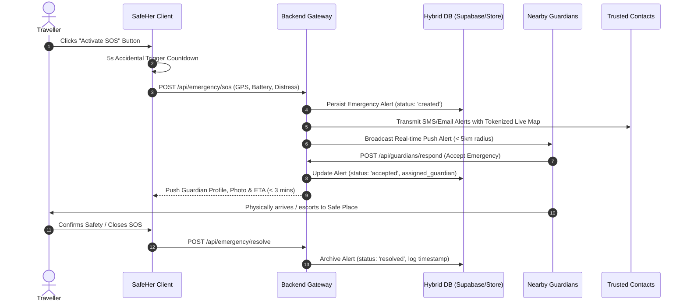
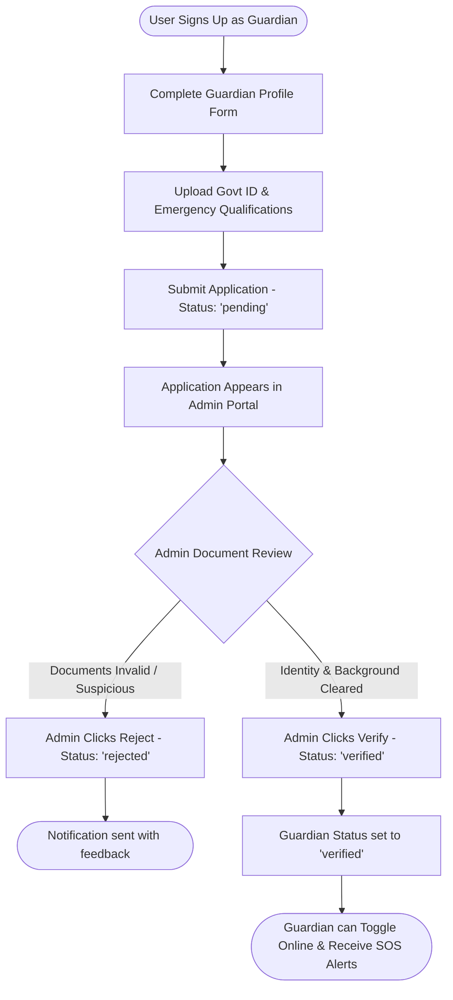

# SafeHer — Product Requirements Document (PRD)

**Document Version:** 1.0.0  
**Status:** Approved & Implemented  
**Product Name:** SafeHer  
**Tagline:** *"Travel Freely. Stay Safely."*  
**Category:** Women Safety | Travel Tech | Social Impact | Smart Geolocation Web Application  
**Author / Engineering Team:** SafeHer Core Architecture & Product Engineering Team  
**Last Updated:** November 2026  

---

## 1. Executive Summary

**SafeHer** is a women-first travel safety and emergency assistance web platform designed to empower solo women travellers to explore unfamiliar cities with confidence, dignity, and real-time protection. 

Unlike traditional "panic button" applications that only trigger after an assault or crisis has occurred, SafeHer creates a **proactive, ambient safety ecosystem**. It bridges the gap between digital geolocation tracking, artificial intelligence guidance, verified community human escorts ("Guardians"), physical safe shelters ("Safe Havens"), and statutory emergency dispatch services (Police & Hospitals).

### Mission Statement
> *"To eradicate the fear of solo travel for women worldwide through real-time ambient monitoring, community-driven guardian networks, and proactive artificial intelligence."*

---

## 2. Problem Statement & Market Opportunity

### 2.1 The Core Problem
1. **Fear and Friction in Unfamiliar Locations:** Over 73% of solo women travellers report that personal safety is their primary barrier to exploring new cities, taking night transit, or venturing off traditional tourist trails.
2. **Delayed & Ineffective Emergency Response:** Conventional emergency helplines often suffer from high latency (8–15 minutes dispatch time), language barriers in foreign states/countries, and imprecise verbal location reporting.
3. **Absence of Immediate Physical Human Presence:** Digital alerts to distant family members cause panic without offering immediate physical protection on the ground.
4. **Lack of Verified Safe Haven Information:** Travellers in transit lack curated, real-time knowledge of 24/7 well-lit establishments, verified women-friendly police booths, or emergency medical facilities within walking distance.

### 2.2 Target Market & Demographics
- **Primary Audience:** Solo women travellers, solo backpackers, working professionals commuting late at night, and female university students relocating to new metro zones.
- **Secondary Audience:** Community volunteers, retired service personnel, and local women business owners acting as verified "Guardians".
- **Tertiary Audience:** Family members, emergency contacts, and corporate travel risk management teams.

---

## 3. User Personas

| Attribute | Persona 1: The Solo Explorer | Persona 2: The Community Guardian | Persona 3: Platform Administrator |
| :--- | :--- | :--- | :--- |
| **Name** | Priya Sharma | Sunita Rao | Vikram Malhotra |
| **Role** | Traveller | Verified Guardian | Trust & Safety Operations Lead |
| **Age / Location** | 26, New Delhi / Traveling to Jaipur | 39, Connaught Place, New Delhi | 34, Central Operations HQ |
| **Pain Points** | Anxious in late-night cabs; unfamiliar with street safety; needs mother to be assured without constant calling. | Wants to give back to female safety; frustrates with unverified vigilante groups; needs structured legal backing. | Needs zero fraud tolerance; must verify guardian IDs; needs real-time oversight of critical emergencies. |
| **Key Goal** | Seamless journey tracking, instant 1-tap SOS, and immediate verified guardian dispatch. | Receive verified emergency broadcasts, escort nearby travellers to safe spots, maintain high reliability score. | Review document proofs, approve/reject guardians, monitor SOS escalations, prevent platform abuse. |

---

## 4. Product Vision & Core Value Pillars

```
+-------------------------------------------------------------------------+
|                               SAFEHER CORE                              |
+-------------------------------------------------------------------------+
           |                         |                         |
           v                         v                         v
+---------------------+   +---------------------+   +---------------------+
|      PREVENT        |   |       PROTECT       |   |       EMPOWER       |
| Ambient Journey     |   | Smart Emergency SOS |   | Verified Guardians  |
| Monitoring & AI     |   | Dynamic Escalation  |   | 3D Global Network   |
| Risk Advisory       |   | Safe Haven Routing  |   | Community Wisdom    |
+---------------------+   +---------------------+   +---------------------+
```

1. **Ambient Prevention:** Geolocation-aware journey monitoring with expected arrival deadlines, battery reporting, and automated notifications to trusted contacts.
2. **Immediate Protection:** Single-tap Emergency SOS with rapid 3-level escalation, live audio beacons, and nearest verified Safe Haven navigation.
3. **Decentralized Guardian Network:** Admin-vetted local human guardians who can reach an incident scene within sub-3-minute windows in dense metro zones.
4. **Intelligent Safety Copilot:** Multilingual AI assistant powered by Google Gemini, capable of giving immediate cultural safety tips, legal rights summaries, and local emergency phrasebooks.

---

## 5. Functional Requirements (FR Matrix)

### FR-1: Smart Emergency SOS System (P0 - Critical)
- **FR-1.1:** Prominent, high-contrast, one-tap Emergency SOS button available across all pages and traveller views.
- **FR-1.2:** 5-second accidental trigger countdown with cancel button and haptic/audio confirmation.
- **FR-1.3:** Immediate transmission of precise GPS coordinates (latitude, longitude, accuracy radius), battery percentage, timestamp, and optional distress message.
- **FR-1.4:** Multi-tier escalation engine:
  - *Tier 1:* Automated SMS/Email alerts to all primary Trusted Contacts with live tracking link.
  - *Tier 2:* Push notification broadcast to all active, verified Guardians within a 5 km radius.
  - *Tier 3:* One-touch integration to local emergency services (112 / 1091 Women Helpline).
- **FR-1.5:** Real-time SOS status tracker (Created -> Notified -> Accepted -> Responding -> Resolved).

### FR-2: Verified Community Guardian Network (P0 - Critical)
- **FR-2.1:** Strict onboarding application requiring Government Photo ID (Aadhaar, Passport, Voter Card) and emergency background details.
- **FR-2.2:** Multi-state verification workflow: `pending` -> `verified` or `rejected`. **Zero self-verification permitted.**
- **FR-2.3:** Guardian availability toggle (Online / Offline status) with live coordinate updates.
- **FR-2.4:** Emergency dispatch card displaying traveller distance, ETA, route, and direct emergency call capability.
- **FR-2.5:** Assist history, performance rating (1 to 5 stars), and badge milestones (e.g., "First Aid Certified").

### FR-3: Ambient Journey Monitoring & Public Tokenized Tracking (P1 - High)
- **FR-3.1:** Origin-to-Destination journey creation with expected arrival timestamp.
- **FR-3.2:** Generation of a secure, tokenized public sharing URL (e.g., `/track/SAFE-TRACK-XXXX`).
- **FR-3.3:** Zero-login tracking page allowing non-registered family members to view live progress, current battery level, and safety status.
- **FR-3.4:** Automatic check-in timer: prompts the user if arrival is delayed by > 15 minutes without status update.

### FR-4: Safe Places & Physical Safe Haven Locator (P1 - High)
- **FR-4.1:** Interactive geospatial map rendering verified safe locations categorized by:
  - Women Police Stations & 24/7 Assistance Desks
  - Emergency Trauma Hospitals & Government Clinics
  - 24/7 Pharmacies & Medical Centers
  - CISF-monitored Transit Hubs & Metro Interchanges
  - Verified 24-hour Safe Haven Cafes & Partner Shelters
- **FR-4.2:** Filter by category, open hours, and user distance.
- **FR-4.3:** Turn-by-turn routing via OpenStreetMap / Leaflet integration.

### FR-5: Multilingual AI Safety Copilot & Emergency Phrasebook (P1 - High)
- **FR-5.1:** Conversational AI safety assistant powered by Google Gemini 1.5.
- **FR-5.2:** Geolocation-aware advice: customizes tips based on user's current city and time of day.
- **FR-5.3:** Built-in offline emergency phrasebook with phonetics in Hindi, French, Spanish, German, and Japanese (e.g., "Someone is following me", "Call police immediately").
- **FR-5.4:** Instant emergency escalation from within chat if distress keywords are identified.

### FR-6: 3D Interactive World Testimonial Globe (P1 - High)
- **FR-6.1:** 3D interactive WebGL sphere displaying real-time global SafeHer guardian clusters and solo traveller feedback.
- **FR-6.2:** Interactive HTML pins anchored to true geographic coordinates (Delhi, Paris, London, Tokyo, São Paulo, Sydney, Cape Town).
- **FR-6.3:** Touch, drag, momentum swipe, and keyboard navigation with spring physics.
- **FR-6.4:** Autoplay tour mode cycling through featured reviews with accessible screen reader announcements.

### FR-7: Role-Based Authentication & Access Control (P0 - Critical)
- **FR-7.1:** Secure registration and login supporting three distinct roles:
  - `traveller`
  - `guardian`
  - `admin`
- **FR-7.2:** Protected routes with automated redirect guards.
- **FR-7.3:** One-click demo login buttons for frictionless prototype testing and evaluation.

### FR-8: Admin Trust & Safety Governance Portal (P0 - Critical)
- **FR-8.1:** Centralized dashboard displaying total users, active journeys, pending guardian applications, and open SOS alerts.
- **FR-8.2:** Guardian application inspection modal with document preview, applicant background, and one-click Approve/Reject actions.
- **FR-8.3:** Live emergency monitoring console displaying real-time SOS incidents with audit trail and resolution controls.

---

## 6. User Journeys & Workflow Diagrams

### 6.1 Emergency SOS Activation & Resolution Flow


### 6.2 Guardian Verification & Onboarding Flow


---

## 7. Non-Functional Requirements (NFRs)

| Category | Requirement | Metric / Specification |
| :--- | :--- | :--- |
| **Performance** | SOS Alert Broadcast Latency | `< 1.5 seconds` from button tap to DB persistence and socket broadcast. |
| **Availability** | Platform Uptime | `99.9%` target uptime. Local persistent store failover if cloud DB is unreachable. |
| **Accessibility** | High Stress Accessibility | WCAG 2.1 AA compliant. Minimum 4.5:1 color contrast; SOS button exceeds 64x64px touch target. |
| **Mobile Responsiveness** | Device Compatibility | Fluid responsive layouts supporting iOS Safari, Android Chrome, and Desktop browsers. |
| **Security & Privacy** | Geolocation Protection | Ephemeral location sharing. Exact coordinates of non-emergency journeys expire 24h post-completion. |
| **Data Protection** | Secret Management | Zero client-side API secret keys. Strict CORS whitelist and Helmet security headers. |

---

## 8. Product KPIs & Success Metrics

1. **Safety Incident Resolution Time (SIRT):** Median time from SOS initiation to guardian acceptance (< 3 minutes).
2. **Guardian Network Density:** Number of active, verified guardians per 10 square kilometers in urban testbeds.
3. **Emergency False-Alarm Cancellation Rate:** Percentage of false alerts cancelled during the 5-second countdown grace window.
4. **Safety Confidence Score:** User satisfaction rating collected post-journey (target: ≥ 4.8 / 5.0).
5. **Guardian Verification Throughput:** Admin review turnaround under 24 hours from application submission.

---

## 9. Product Roadmap

- **Phase 1 (Current - v1.0 Production Ready):**
  - Full-Stack SafeHer Web Application.
  - Role-based Auth (Traveller, Guardian, Admin).
  - Smart SOS & Live Journey Tracking.
  - OpenStreetMap Safe Places Locator.
  - Google Gemini AI Safety Assistant & Multilingual Phrasebook.
  - 3D Interactive World Testimonial Globe.
- **Phase 2 (v1.5 - Mobile & IoT Integration):**
  - Progressive Web App (PWA) with offline push notifications and service worker caching.
  - Bluetooth BLE panic button / smart jewelry pairing.
  - Audio-based scream detection heuristic in browser.
- **Phase 3 (v2.0 - Global Community Scale):**
  - Integration with municipal emergency dispatch APIs (E911, 112 Europe, 1091 India).
  - Corporate travel safety dashboard for solo female employees.
  - Guardian peer background check & decentralized identity verification (DID).
