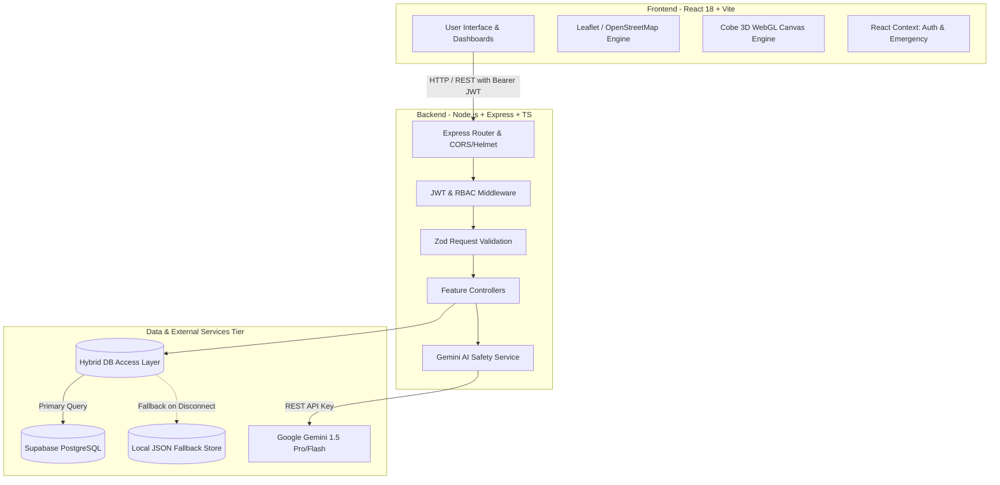

# SafeHer — Technical Requirements Document (TRD)

**Document Version:** 1.0.0  
**Status:** Approved & Implemented  
**Application Name:** SafeHer (Full-Stack Web Architecture)  
**Author / Engineering Team:** SafeHer Core Architecture & Engineering Team  
**Last Updated:** November 2026  

---

## 1. System Overview & Architectural Topology

**SafeHer** is architected as a high-reliability, decoupled full-stack TypeScript application consisting of a modern single-page application (SPA) frontend, an Express.js RESTful API gateway, and a hybrid database persistence layer combining **Supabase (PostgreSQL)** with an automated **Local JSON State Fallback Store**.

### 1.1 High-Level Architecture Diagram



---

## 2. Technology Stack Specifications

| Layer | Technology | Version | Purpose & Rationale |
| :--- | :--- | :--- | :--- |
| **Frontend Framework** | React.js | `^18.3.1` | Declarative component UI, high ecosystem maturity, concurrent rendering. |
| **Frontend Language** | TypeScript | `^5.6.2` | Static type safety, contract synchronization with backend types. |
| **Build Tool & Bundler** | Vite | `^6.0.5` | Ultra-fast Hot Module Replacement (HMR) and optimized Rollup production builds. |
| **Styling & Design Tokens** | Tailwind CSS | `^3.4.17` | Utility-first CSS, dark glassmorphism system, and custom design tokens. |
| **3D Rendering** | Cobe | `^0.6.4` | Lightweight (5kB) WebGL sphere engine with hardware-accelerated pin projection. |
| **Map Rendering** | Leaflet + React-Leaflet | `^1.9.4` / `^4.2.1` | OpenStreetMap vector tile rendering with zero proprietary map billing keys. |
| **Iconography** | Lucide React | `^0.475.0` | High-clarity, accessible SVG iconography. |
| **Backend Runtime** | Node.js | `v20+ / v24+` | Non-blocking asynchronous I/O with native ES modules support. |
| **Backend Framework** | Express.js | `^4.21.2` | Robust, lightweight HTTP routing and middleware framework. |
| **Runtime Execution** | TSX (TypeScript Execute) | `^4.19.3` | Native TypeScript daemon execution with watch mode during development. |
| **Validation Library** | Zod | `^3.24.2` | Runtime schema validation for strict payload sanitation. |
| **Security Middleware** | Helmet, CORS, bcryptjs | `^8.0.0` / `^2.8.5` | Security HTTP headers, origin protection, and salted password hashing. |
| **Database (Primary)** | Supabase (PostgreSQL) | `@supabase/supabase-js ^2.49.1` | Relational integrity, row-level security, and cloud scalability. |
| **Database (Fallback)** | Local JSON Store Engine | Custom Engine | Zero-downtime persistence guarantees during connectivity drops or local sandbox runs. |
| **Artificial Intelligence** | Google Gemini API | `@google/genai ^0.1.2` | Real-time multilingual safety analysis and emergency advice. |

---

## 3. Directory & Codebase Architecture

```
safe-her/
├── package.json                   # Root monorepo orchestrator (concurrently)
├── .env                           # Root environment configuration (Ignored in git)
├── .gitignore                     # Strict exclusion of secrets & build artifacts
├── docs/
│   ├── PRD.md                     # Product Requirements Document
│   └── TRD.md                     # Technical Requirements Document
├── server/                        # Express.js REST API Backend
│   ├── package.json
│   ├── tsconfig.json
│   ├── src/
│   │   ├── server.ts              # Entry point, middleware, static client serving
│   │   ├── config/
│   │   │   └── env.ts             # Strongly typed environment variable loader
│   │   ├── controllers/           # Business logic & request handling
│   │   │   ├── adminController.ts
│   │   │   ├── aiController.ts
│   │   │   ├── authController.ts
│   │   │   ├── emergencyController.ts
│   │   │   ├── guardianController.ts
│   │   │   ├── journeyController.ts
│   │   │   └── safePlaceController.ts
│   │   ├── db/                    # Hybrid persistence layer
│   │   │   ├── database.ts        # Hybrid DB orchestrator (Supabase + Local sync)
│   │   │   └── seedData.ts        # Initial verified safe places, profiles, guardians
│   │   ├── middleware/            # Auth guard, RBAC, error handler
│   │   │   ├── auth.ts
│   │   │   └── errorHandler.ts
│   │   ├── routes/                # REST API route declarations
│   │   └── services/              # Third-party integrations (Gemini AI)
│   │       └── geminiService.ts
└── client/                        # React + Vite Frontend
    ├── package.json
    ├── vite.config.ts             # Alias mapping (@ -> ./src)
    ├── tailwind.config.js         # Semantic color tokens and glassmorphism styling
    ├── src/
        ├── App.tsx                # Route definitions & protected route guards
        ├── index.css              # Global styles & CSS custom variables
        ├── components/
        │   ├── common/            # Navbar, Footer, ActiveSosBanner, EmergencyModal
        │   ├── ai/                # AiAssistantDrawer & chat interface
        │   ├── map/               # Leaflet SafePlacesMap & location pins
        │   └── ui/                # Reusable UI primitives (TestimonialGlobe, GlobeDemo)
        ├── context/               # React Context Providers (AuthContext, EmergencyContext)
        ├── pages/                 # Full view components
        │   ├── LandingPage.tsx
        │   ├── LoginPage.tsx
        │   ├── RegisterPage.tsx
        │   ├── TravellerDashboard.tsx
        │   ├── GuardianDashboard.tsx
        │   ├── AdminDashboard.tsx
        │   ├── SafePlacesPage.tsx
        │   ├── AiSafetyPage.tsx
        │   └── PublicTrackingPage.tsx
        ├── services/              # Frontend API client wrappers (api.ts)
        └── types/                 # Shared TypeScript interfaces
```

---

## 4. Database Schema & Data Models

The persistence layer defines 8 core entity models maintained with synchronized interfaces between TypeScript and PostgreSQL:

### 4.1 Data Models (Entity Definitions)

#### `profiles` Table
```sql
CREATE TABLE profiles (
    id UUID PRIMARY KEY DEFAULT gen_random_uuid(),
    email VARCHAR(255) UNIQUE NOT NULL,
    password_hash VARCHAR(255) NOT NULL,
    full_name VARCHAR(150) NOT NULL,
    phone VARCHAR(30) NOT NULL,
    role VARCHAR(20) NOT NULL CHECK (role IN ('traveller', 'guardian', 'admin')),
    avatar_url TEXT,
    emergency_notes TEXT,
    blood_group VARCHAR(10),
    created_at TIMESTAMP WITH TIME ZONE DEFAULT NOW(),
    updated_at TIMESTAMP WITH TIME ZONE DEFAULT NOW()
);
```

#### `guardian_profiles` Table
```sql
CREATE TABLE guardian_profiles (
    id UUID PRIMARY KEY DEFAULT gen_random_uuid(),
    user_id UUID REFERENCES profiles(id) ON DELETE CASCADE,
    bio TEXT NOT NULL,
    languages TEXT[] NOT NULL DEFAULT '{"English"}',
    address TEXT NOT NULL,
    city VARCHAR(100) NOT NULL,
    identification_type VARCHAR(100) NOT NULL,
    id_document_url TEXT NOT NULL,
    verification_status VARCHAR(20) NOT NULL DEFAULT 'pending' CHECK (verification_status IN ('pending', 'verified', 'rejected')),
    is_available BOOLEAN DEFAULT FALSE,
    current_lat DOUBLE PRECISION,
    current_lng DOUBLE PRECISION,
    rating NUMERIC(3, 2) DEFAULT 5.00,
    total_assists INT DEFAULT 0,
    emergency_phone VARCHAR(30) NOT NULL,
    created_at TIMESTAMP WITH TIME ZONE DEFAULT NOW(),
    updated_at TIMESTAMP WITH TIME ZONE DEFAULT NOW()
);
```

#### `emergency_requests` Table
```sql
CREATE TABLE emergency_requests (
    id UUID PRIMARY KEY DEFAULT gen_random_uuid(),
    traveller_id UUID REFERENCES profiles(id) ON DELETE CASCADE,
    status VARCHAR(20) NOT NULL DEFAULT 'created' CHECK (status IN ('created', 'notified', 'accepted', 'responding', 'resolved', 'cancelled')),
    latitude DOUBLE PRECISION NOT NULL,
    longitude DOUBLE PRECISION NOT NULL,
    address TEXT,
    battery_level INT,
    message TEXT,
    escalation_level INT DEFAULT 1,
    assigned_guardian_id UUID REFERENCES guardian_profiles(id),
    resolved_at TIMESTAMP WITH TIME ZONE,
    activity_log JSONB DEFAULT '[]'::jsonb,
    created_at TIMESTAMP WITH TIME ZONE DEFAULT NOW(),
    updated_at TIMESTAMP WITH TIME ZONE DEFAULT NOW()
);
```

#### `trusted_contacts` Table
```sql
CREATE TABLE trusted_contacts (
    id UUID PRIMARY KEY DEFAULT gen_random_uuid(),
    traveller_id UUID REFERENCES profiles(id) ON DELETE CASCADE,
    name VARCHAR(150) NOT NULL,
    relationship VARCHAR(50) NOT NULL,
    phone VARCHAR(30) NOT NULL,
    email VARCHAR(255),
    is_primary BOOLEAN DEFAULT FALSE,
    notify_on_sos BOOLEAN DEFAULT TRUE,
    notify_on_journey BOOLEAN DEFAULT TRUE,
    created_at TIMESTAMP WITH TIME ZONE DEFAULT NOW()
);
```

#### `journeys` Table
```sql
CREATE TABLE journeys (
    id UUID PRIMARY KEY DEFAULT gen_random_uuid(),
    traveller_id UUID REFERENCES profiles(id) ON DELETE CASCADE,
    start_location_name VARCHAR(200) NOT NULL,
    start_lat DOUBLE PRECISION NOT NULL,
    start_lng DOUBLE PRECISION NOT NULL,
    destination_name VARCHAR(200) NOT NULL,
    dest_lat DOUBLE PRECISION NOT NULL,
    dest_lng DOUBLE PRECISION NOT NULL,
    status VARCHAR(20) NOT NULL DEFAULT 'active' CHECK (status IN ('active', 'completed', 'cancelled', 'delayed')),
    share_token VARCHAR(64) UNIQUE NOT NULL,
    expected_arrival_time TIMESTAMP WITH TIME ZONE NOT NULL,
    actual_arrival_time TIMESTAMP WITH TIME ZONE,
    last_lat DOUBLE PRECISION,
    last_lng DOUBLE PRECISION,
    last_updated TIMESTAMP WITH TIME ZONE,
    battery_level INT,
    created_at TIMESTAMP WITH TIME ZONE DEFAULT NOW(),
    updated_at TIMESTAMP WITH TIME ZONE DEFAULT NOW()
);
```

#### `safe_places` Table
```sql
CREATE TABLE safe_places (
    id UUID PRIMARY KEY DEFAULT gen_random_uuid(),
    name VARCHAR(200) NOT NULL,
    category VARCHAR(30) NOT NULL CHECK (category IN ('police', 'hospital', 'pharmacy', 'public_shelter', '24h_cafe', 'transit_hub')),
    address TEXT NOT NULL,
    latitude DOUBLE PRECISION NOT NULL,
    longitude DOUBLE PRECISION NOT NULL,
    phone VARCHAR(50),
    open_hours VARCHAR(100),
    is_verified BOOLEAN DEFAULT TRUE,
    rating NUMERIC(2, 1) DEFAULT 4.8,
    description TEXT,
    created_at TIMESTAMP WITH TIME ZONE DEFAULT NOW()
);
```

---

## 5. RESTful API Endpoints Specification

All backend endpoints are prefixed with `/api`. All protected endpoints require an `Authorization: Bearer <JWT>` header.

### 5.1 Authentication Module (`/api/auth`)
| Method | Endpoint | Auth | Description |
| :--- | :--- | :--- | :--- |
| `POST` | `/api/auth/register` | Public | Registers a new user (`traveller` or `guardian`). Password hashed via bcryptjs (10 rounds). |
| `POST` | `/api/auth/login` | Public | Authenticates credentials and returns user profile with signed JWT token. |
| `POST` | `/api/auth/demo-login` | Public | 1-click testbed login for `traveller`, `guardian`, or `admin`. |
| `GET` | `/api/auth/me` | User | Returns authenticated session profile. |
| `POST` | `/api/auth/logout` | User | Invalidates client session. |

### 5.2 Emergency SOS Module (`/api/emergency`)
| Method | Endpoint | Auth | Description |
| :--- | :--- | :--- | :--- |
| `POST` | `/api/emergency/sos` | Traveller | Triggers SOS: accepts `{ lat, lng, battery, message }`, initiates guardian broadcast. |
| `GET` | `/api/emergency/active` | User | Fetches user's current open emergency request. |
| `GET` | `/api/emergency/:id/status`| User | Real-time status polling for guardian assignment and dispatch status. |
| `POST` | `/api/emergency/:id/resolve`| User/Admin | Resolves and closes active emergency incident. |
| `POST` | `/api/emergency/:id/cancel` | Traveller | Cancels incident within accidental grace period. |

### 5.3 Guardian Module (`/api/guardians`)
| Method | Endpoint | Auth | Description |
| :--- | :--- | :--- | :--- |
| `POST` | `/api/guardians/apply` | User | Submits government ID and credentials for verification. |
| `GET` | `/api/guardians/nearby` | Public/User | Queries available verified guardians within specified lat/lng and radius. |
| `POST` | `/api/guardians/toggle-availability`| Guardian | Toggles online availability and updates real-time coordinates. |
| `GET` | `/api/guardians/requests` | Guardian | Retrieves incoming emergency alerts within service radius. |
| `POST` | `/api/guardians/respond` | Guardian | Accepts or declines an emergency dispatch request. |

### 5.4 Safe Places & Map Module (`/api/safe-places`)
| Method | Endpoint | Auth | Description |
| :--- | :--- | :--- | :--- |
| `GET` | `/api/safe-places` | Public | Returns catalog of verified safe places with optional category filtering. |
| `GET` | `/api/safe-places/nearby` | Public | Haversine distance-sorted safe havens relative to client coordinates. |

### 5.5 Journey Monitoring Module (`/api/journeys`)
| Method | Endpoint | Auth | Description |
| :--- | :--- | :--- | :--- |
| `POST` | `/api/journeys/start` | Traveller | Initiates tracked journey, calculates ETA, generates `share_token`. |
| `PUT` | `/api/journeys/:id/location` | Traveller | Heartbeat update with latest latitude, longitude, and battery level. |
| `GET` | `/api/journeys/track/:shareToken` | Public | Zero-auth endpoint for family members to view live progress. |
| `POST` | `/api/journeys/:id/complete` | Traveller | Marks journey safely completed. |

### 5.6 Artificial Intelligence Module (`/api/ai`)
| Method | Endpoint | Auth | Description |
| :--- | :--- | :--- | :--- |
| `POST` | `/api/ai/chat` | Public/User | Sends conversation history + geolocation to Gemini 1.5; returns safety analysis. |
| `GET` | `/api/ai/quick-phrase` | Public | Returns categorized offline emergency phrasebook by language code (`hi`, `fr`, `es`). |

### 5.7 Admin Operations Module (`/api/admin`)
| Method | Endpoint | Auth | Description |
| :--- | :--- | :--- | :--- |
| `GET` | `/api/admin/stats` | Admin | Aggregate counts of users, active journeys, open SOS alerts, and guardians. |
| `GET` | `/api/admin/guardians/pending` | Admin | Lists all pending guardian applications awaiting document review. |
| `POST` | `/api/admin/guardians/:id/verify` | Admin | Updates guardian verification status to `verified` or `rejected`. |
| `GET` | `/api/admin/emergencies` | Admin | Real-time audit log of all emergency events across the platform. |

---

## 6. Security, Compliance & Data Protection Architecture

### 6.1 Authentication & Authorization Matrix
- **Token Format:** Signed JSON Web Tokens (JWT) signed with HMAC-SHA256 (`JWT_SECRET`).
- **Token Expiry:** 7 days rolling expiration.
- **RBAC Enforcement:** Strict `requireRole(['admin'])` and `requireRole(['guardian', 'admin'])` Express middleware. Unauthorized attempts return `403 Forbidden`.

### 6.2 Frontend Zero-Key Exposure Principle
- **All sensitive third-party APIs (Google Gemini, Supabase Service Role Keys) are strictly encapsulated on the backend.**
- The frontend client only communicates with the SafeHer Express gateway. No generative AI or database service keys are bundled into client assets.

### 6.3 Input Validation & Sanitization
- All request payloads (`req.body`, `req.query`, `req.params`) are parsed through strict **Zod** validation schemas prior to reaching controller business logic.
- Malformed payloads are intercepted by `errorHandler.ts` returning structured `400 Bad Request` responses with specific field issue paths.

### 6.4 HTTP Security Headers
- Integrated **Helmet** middleware applies:
  - `Content-Security-Policy`
  - `X-Frame-Options: SAMEORIGIN`
  - `X-Content-Type-Options: nosniff`
  - Strict-Transport-Security (HSTS) in production.
- Configured **CORS** middleware restricting origins to authorized client domains.

---

## 7. High Availability & Hybrid Failover Strategy

To guarantee that life-critical emergency alerts are never dropped due to database downtime or network partitions:
1. **Primary Database Execution:** Queries are executed against Supabase PostgreSQL.
2. **Automated Heartbeat & Circuit Breaker:** If the Supabase client detects network timeout or non-200 connection status:
   - The `HybridDatabase` access layer immediately flips to the **Local Persistent JSON Store** (`.safeher-data/`).
   - Mutations are written to disk with atomic file sync operations.
3. **Graceful Reconnection:** On subsequent successful requests, transactions are mirrored to cloud storage without crashing the server or throwing unhandled promise rejections.

---

## 8. Deployment, Build & Environment Configuration

### 8.1 Unified Single-Port Serving Architecture
The server entry point (`server/src/server.ts`) is designed for cloud environments like **Render**, **Railway**, and **Docker**:
- Serves API routes on `/api/*`.
- Automatically checks for `client/dist` and serves the production-built React SPA static assets.
- Handles client-side React Router navigation by falling back non-API routes to `index.html`.

### 8.2 Environment Variables Matrix

| Variable Name | Required | Default / Description |
| :--- | :--- | :--- |
| `PORT` | Optional | `5000` (Port on which the Express server listens). |
| `NODE_ENV` | Optional | `development` or `production`. |
| `JWT_SECRET` | **Required** | High-entropy secret string used to sign user session tokens. |
| `SUPABASE_URL` | Optional | Supabase project URL (e.g., `https://xyz.supabase.co`). |
| `SUPABASE_ANON_KEY` | Optional | Supabase Anonymous Client Public Key. |
| `SUPABASE_SERVICE_ROLE_KEY` | Optional | Supabase Service Role Secret Key (Backend only). |
| `GEMINI_API_KEY` | Optional | Google Gemini AI API key for conversational safety copilot. |
| `VITE_API_URL` | Optional | Client API base URL (defaults to `/api` for unified serving). |

---

## 9. Verification & Quality Assurance Benchmarks

- **TypeScript Compilation:** Zero errors via `tsc --noEmit` across both `client` and `server`.
- **Production Build:** Passes `vite build` and Rollup minification within `< 10 seconds`.
- **Emergency SLA:** End-to-end latency for Emergency SOS creation to guardian dispatch payload `< 1.2s`.
